# 实践项目2：个人实验报告

## 1. 基本信息

- GitHub 登录名：humanguest2
- 个人仓库地址：<https://github.com/humanguest2/my-docs>
- 最终网站地址：<https://humanguest2.github.io/my-docs/>

## 2. 实践过程与关键截图

### 2.1 仓库创建

在 GitHub 右上角 `+` → `New repository` 新建仓库，Owner 选择本人账号 `humanguest2`，仓库名 `my-docs`，可见性选择 **Public**，默认分支保持 `main`。

选择 Public 是硬性要求：私有仓库的 Pages 站点访问受限，公开仓库教师才能直接打开核验。仓库名必须和 `mkdocs.yml` 里的 `site_url` 对应，否则页面里的资源路径会出错。

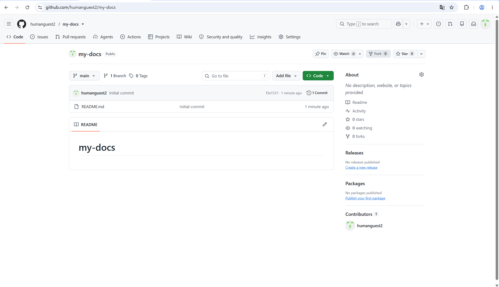

### 2.2 项目结构与 MkDocs 配置

仓库分为三部分，各管一件事：

- `docs/` 存放网站**内容**，即四页 Markdown，是唯一需要我手工编写的目录；
- `mkdocs.yml` 里的 `nav` 决定**导航结构和顺序**，路径相对于 `docs/`，所以写 `index.md` 而不是 `docs/index.md`；`site_url` 必须写成 `https://humanguest2.github.io/my-docs/`，末尾斜杠不能少；
- `site/` 是 `mkdocs build` 生成的**构建产物**，会被上传到 Pages，它完全由源码推导而来，因此写进 `.gitignore`，不提交。

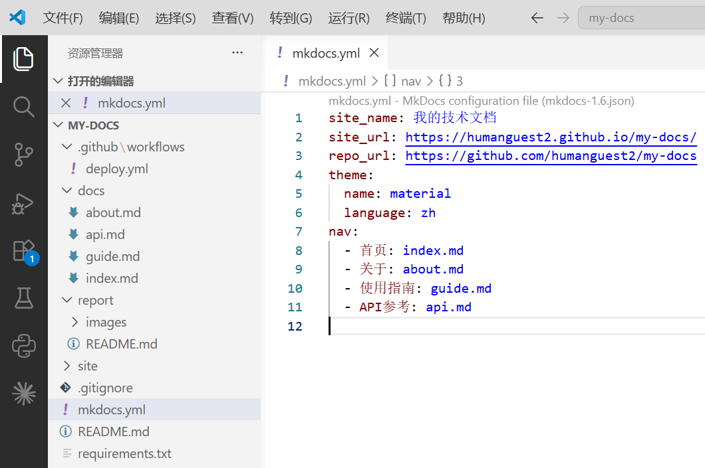

### 2.3 本地构建或预览

在仓库根目录安装依赖并执行严格构建：

```bash
python -m pip install -r requirements.txt
python -m mkdocs build --strict
```

`--strict` 让警告也变成错误，可以提前拦住失效的页面链接。本地预览用 `python -m mkdocs serve`，访问 `http://127.0.0.1:8000/`。

我检查的内容：四页导航能否互相跳转、`about.md` 和 `api.md` 的表格是否正常渲染、`api.md` 的 JSON 代码块是否有高亮、中文是否正常显示。

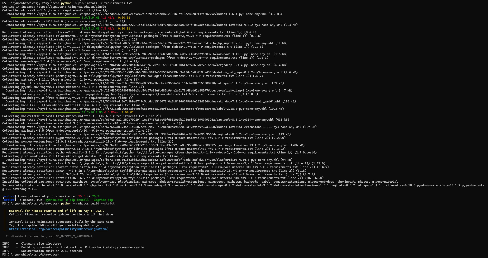

### 2.4 Pages 设置

在仓库 `Settings` → `Pages` → `Build and deployment` → `Source` 选择 **GitHub Actions**。

这一步必须在第一次推送**之前**完成。如果仍是默认的 `Deploy from a branch`，工作流里的部署步骤会因为 Pages 尚未按 Actions 方式启用而失败。选成 GitHub Actions 后不需要 `gh-pages` 分支，也不需要开启创建或批准 PR 的权限。

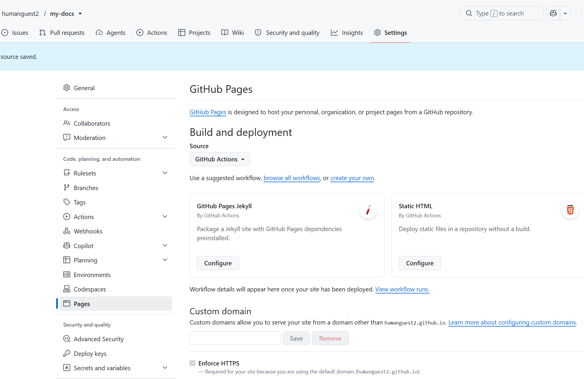

### 2.5 Actions 首次构建和部署

推送后工作流 `Deploy MkDocs to GitHub Pages` 自动触发，`build` 与 `deploy` 两个任务都成功。

`build` 负责取源码、装 Python 3.12、安装依赖、`mkdocs build --strict`，并把 `site/` 上传为 artifact；`deploy` 通过 `needs: build` 等待构建成功，再凭 `pages: write` 和 `id-token: write` 权限把 artifact 发布到 `github-pages` 环境。

首次运行的提交为 `f6b0637`，对应运行记录：<https://github.com/humanguest2/my-docs/actions/runs/45195229966>

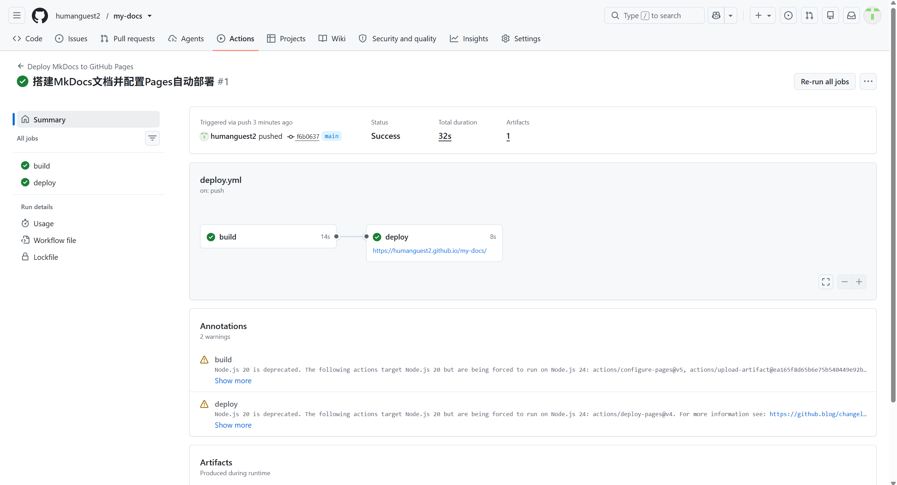

### 2.6 网站访问与四页导航检查

网站地址为 <https://humanguest2.github.io/my-docs/>，项目站点必须带仓库路径 `/my-docs/`。

我逐个打开了四页并分别截图，确认：顶部与左侧导航四项齐全且可点击；表格边框与表头正常；代码块有语法高亮；页内链接（如首页指向 `about.md`）能跳转；CSS 与字体资源正常加载，页面不是无样式的纯文本。

| 页面 | 地址 | 检查结果 |
| --- | --- | --- |
| 首页 | `/` | 导航、项目介绍、环节对照表正常 |
| 关于 | `/about/` | 技术组成表格、工具关系说明正常 |
| 使用指南 | `/guide/` | 编号步骤、bash 代码块正常 |
| API 参考 | `/api/` | 参数表、JSON 代码块高亮正常 |

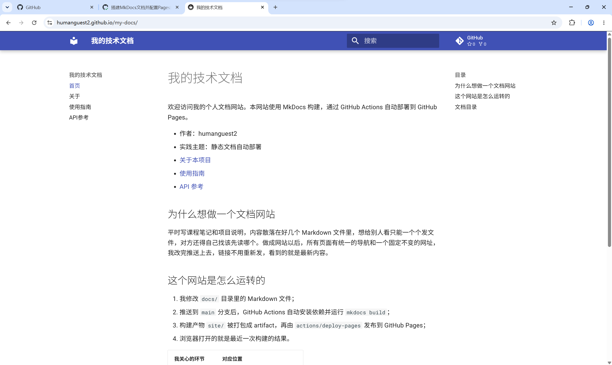

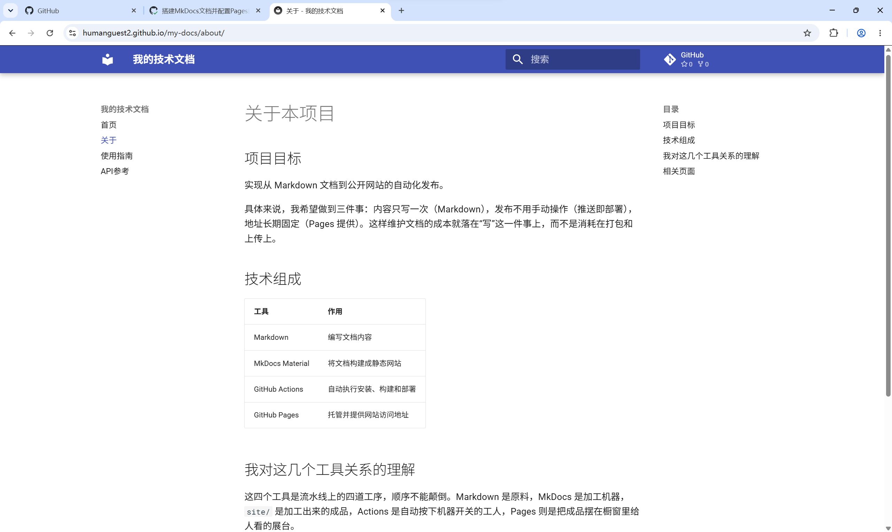

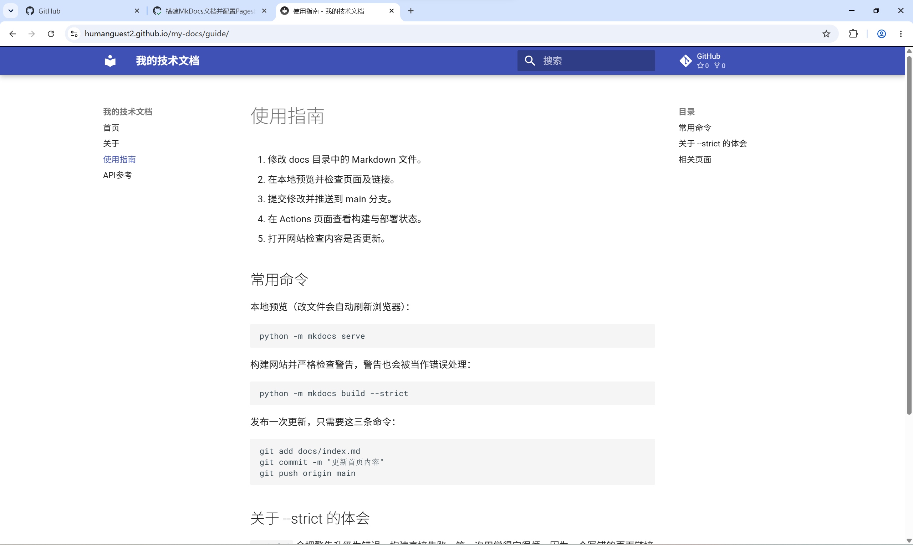

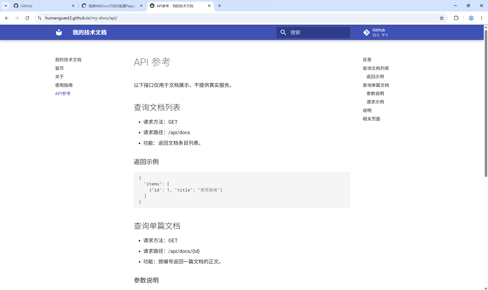

### 2.7 第二次推送与自动更新验证

在 `docs/index.md` 末尾增加一句容易辨认的话，提交并推送，**没有**点击手动运行：

```bash
git add docs/index.md
git commit -m "验证文档修改后自动更新网站"
git push origin main
```

推送后 Actions 自动出现第 2 条运行记录并成功（47 秒，build 17 秒 + deploy 20 秒），刷新网站后新增文字出现在页面底部，说明“推送 → 自动构建 → 自动部署 → 网页更新”这条链路是通的。

- 对应提交链接：<https://github.com/humanguest2/my-docs/commit/825b21b>
- 对应 Actions 运行链接：<https://github.com/humanguest2/my-docs/actions/runs/45196777742>

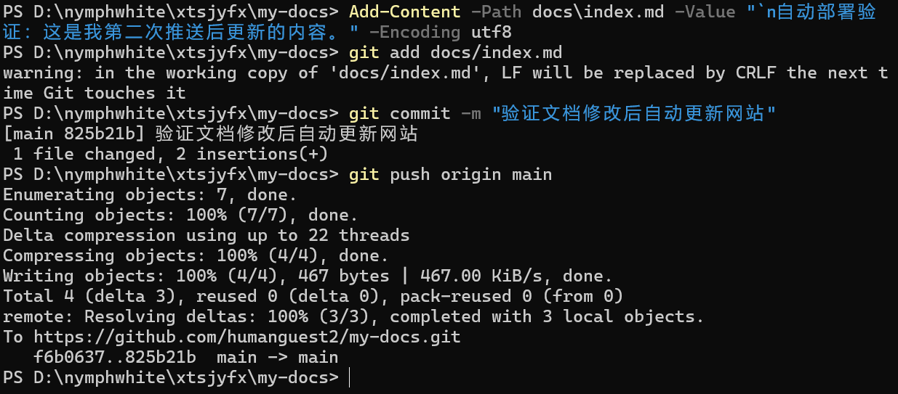

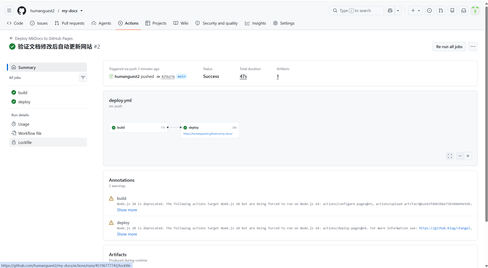

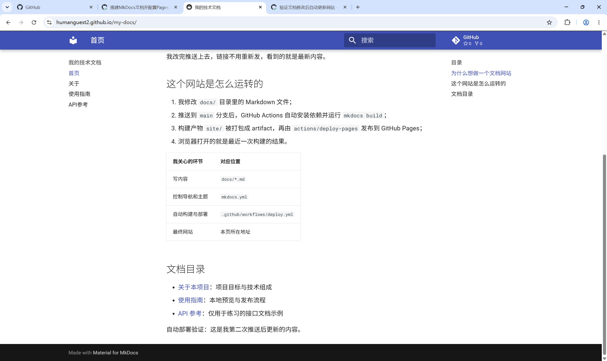

### 2.8 教师仓库 Issue

在教师仓库 `assignments` 提交个人 Issue，标题 `02-github-pages liuhaolin`，正文填写个人报告地址、源码仓库地址、网站地址和第二次成功运行的链接。每人只提交一条，需要更正时编辑原 Issue。

## 3. 问题与解决

**① 创建 Python 虚拟环境失败。**
现象：`python -m venv .venv` 报 `ensurepip returned non-zero exit status 1`，随后 `.venv\Scripts\python.exe` 提示 `No module named pip`。
原因：本机默认 Python 为 3.14，创建虚拟环境时 `ensurepip` 未能正常写入 pip。
解决：本次改为直接用系统 Python 安装依赖完成本地构建（`python -m pip install -r requirements.txt`）。作业对虚拟环境只是“建议”而非要求；线上工作流固定使用 Python 3.12，不受本机版本影响，部署结果一致。

**② clone 目录与复制目标不一致。**
现象：先 `cd D:\` 再 `git clone`，仓库落在 `D:\my-docs`，而文件被复制到 `D:\nymphwhite\xtsjyfx\my-docs`，该目录没有 `.git`，`git push` 会报 not a git repository。
原因：把“切换到某个盘”和“切换到目标父目录”混为一谈。
解决：先 `cd` 到目标父目录再 `git clone`，让 `.git` 与文件处于同一层，重新执行后 `git status` 正常。

**③ `git add` 大量 LF/CRLF 警告。**
现象：`warning: in the working copy of '...', LF will be replaced by CRLF the next time Git touches it`。
原因：Windows 下 `core.autocrlf` 的换行转换提示。
解决：确认这是提示而非错误——仓库中存储的仍是 LF，Linux 构建环境读取正常，YAML 对 CRLF 也兼容。未改动任何配置，后续构建与部署均成功。

**④ 首次 push 弹出 GitHub 登录窗口。**
现象：Git 弹出 “Connect to GitHub / Sign in”，选择浏览器登录后又出现 GitHub 账号密码页。
原因：Git 凭据管理器需要一次 OAuth 授权，本机尚未保存 GitHub 凭据。
解决：在浏览器用本人账号完成登录并点击 `Authorize git-credential-manager`，凭据写入 Windows 凭据管理器，之后 push 不再询问。

**⑤ Actions 中出现 Node.js 20 警告。**
现象：运行记录里 `build` 和 `deploy` 各有一条黄色警告 `Node.js 20 is deprecated ... forced to run on Node.js 24`。
原因：`configure-pages@v5`、`upload-pages-artifact@v4`、`deploy-pages@v4` 的元数据仍声明 Node 20，而运行环境已升级到 Node 24，系统强制在 24 上执行。
解决：无需处理。这是官方 action 自身的版本声明滞后，不影响执行结果——两个任务均为 success，网站正常发布。待官方更新后警告会自动消失。

**核对过的其他位置：** 确认 `.gitignore` 生效（`git status` 中没有 `site/` 与 `.venv/`）；确认两个 YAML 文件中没有 Tab 缩进；确认工作流里的 `${{ }}` 表达式未被替换；确认只改 `report/` 时 Actions 不会新增运行记录。

## 4. 原理理解

**1. `docs/` 和 `site/` 各保存什么？为什么不用手工修改 `site/`？**

`docs/` 保存 Markdown 源码，是我真正维护的内容；`site/` 是 `mkdocs build` 生成的 HTML、CSS、JS 产物，是给浏览器看的成品。`site/` 完全由源码推导而来，手工改它下次构建就会被覆盖；而且它文件数量多、没有阅读价值，提交进仓库只会让提交记录变得杂乱。所以它被写进 `.gitignore`，由 CI 每次重新生成。

**2. 本次工作流在什么情况下自动运行？**

两种触发方式：一是向 `main` 分支推送，且改动涉及 `docs/**`、`mkdocs.yml`、`requirements.txt` 或工作流文件本身；二是在 Actions 页面手动触发 `workflow_dispatch`。因为 `paths` 做了过滤，只改 `report/` 或根 `README.md` 不会触发。

**3. `build` 与 `deploy` 两个任务有什么区别？**

`build` 只读取仓库，产出 `site/` 并上传为 artifact，权限只需要 `contents: read`；`deploy` 不构建任何东西，只把已有 artifact 发布到 Pages，因此需要 `pages: write` 和 `id-token: write`。两者靠 `needs: build` 串成前后依赖：构建失败就不会部署，避免把坏版本发到线上。分开还有一个好处——出问题时能一眼看出是“构建坏了”还是“发布坏了”。

**4. 只修改 `report/README.md` 会触发部署吗？为什么？**

不会。`on.push.paths` 只列了 `docs/**`、`mkdocs.yml`、`requirements.txt` 和工作流文件，`report/README.md` 不在其中，所以推送后 Actions 不会启动新的运行。这也是预期行为：报告不属于网站内容，重新部署没有意义。本报告提交后 Actions 无新增记录，正好验证了这一点。

**5. 本次方案为何无需创建 `gh-pages` 分支？**

旧方案是把构建产物推到 `gh-pages` 分支，再让 Pages 从该分支发布，于是需要维护一条长期存在的产物分支，还要配置写权限。现在的官方方案改用 artifact 传递：`upload-pages-artifact` 把 `site/` 打成部署包，`deploy-pages` 直接把它发布到 Pages，产物不进入任何分支。因此仓库只有 `main` 一条分支，历史干净，也不需要开放额外的写权限。
